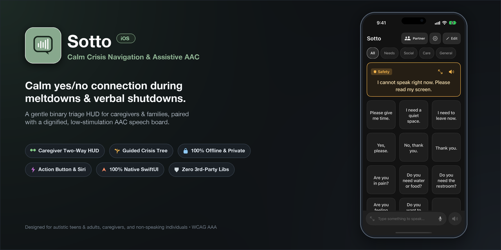

# Sotto for iOS

<p align="center">
  
</p>

**TL;DR**: Sotto (*"under one's breath"*) is a calm yes/no tool for caregivers to reach autistic teens & adults in meltdowns and verbal shutdowns, paired with a dignified, low-stimulation AAC speech board for self-expression.

This repository is the native iOS (SwiftUI) port of [Sotto Android](https://github.com/triton1502oc/Sotto) with 1:1 feature parity and zero third-party dependencies.

---

## Origin & Mission
Sotto was created by a father to navigate overwhelming communication breakdowns and meltdowns with his autistic sons (ages 22 and 15). When sensory overload strikes, speaking, reading long sentences, or processing complex questions becomes exhausting or impossible.

**Primary Mission (Crisis Navigation for Caregivers & Families):**  
Provide parents, siblings, family members, caregivers, therapists, and educators with an immediate two-way receptive triage HUD and low-cognitive-load yes/no inquiry to reach loved ones during meltdowns and shutdowns without escalating distress.

**Secondary Purpose (Dignified Voice for Non-Speaking & Unclear Speech):**  
Provide non-speaking individuals, those with unclear or dysfluent speech, and anyone navigating verbal fatigue with a clean, mature text-to-speech board and spontaneous quick-speak bar—free of pediatric cartoons, patronizing symbols, and visual clutter.

---

## Target Audience
- **Parents, Siblings, Family, Caregivers, Therapists & Teachers**: Reaching loved ones during verbal shutdowns, cognitive freezes, and meltdowns with immediate 1-tap de-escalation; discovering hidden root causes through structured inquiry.
- **Autistic Teens & Adults**: Dignified self-advocacy and daily communication with high-contrast, low-stimulation phrase cards and giant fullscreen text.
- **Individuals with Unclear, Fatigued, or Non-Speaking Speech**: Accessible one-touch speech for motor apraxia, dysarthria, cerebral palsy, ALS, stroke recovery (aphasia), quiet/strained voices, or situational speech loss.

---

## Key Features

### 1. Emergency Triage & Crisis Navigation (Caregiver-First)
- **Two-Way Speak HUD & 180° Flip (`🤝`)**: Immediate emergency de-escalation for acute meltdowns and verbal shutdowns. Caregivers speak naturally or pick urgent preset prompts, flip the display 180° on a table, and the individual responds with one tap (`Yes`, `No`, `Not sure`, `Stop`) with instant voice confirmation. Zero demand fatigue or cognitive load.
- **Why Finder Diagnostic Tree (`🧭`)**: A guided, low-stimulus yes/no branching tree to uncover hidden root causes (acute physical pain, body part location, sensory overload, routine disruption) when triggers are unclear or during post-crisis recovery.
- **Private Why Log & 30-Day Trend Insights**: Automatically logs resolved crisis events locally in private app storage. Highlights top 30-day root-cause patterns and peak time-of-day triggers to help families and therapists identify recurring environmental stressors.
- **Customizable Why Tree (`🌳`)**: Personalize branching questions and resolution steps with voice dictation (`🎤`), sequence reordering, and one-tap clinical defaults reset.

### 2. Dignified Self-Expression (AAC Phrase Board)
- **Low-Stimulus UI & Sensory Color Themes**: Curated sensory-friendly color palettes accessible from Voice & Language Settings (`Appearance` section) to accommodate neurodivergent needs, photophobia, and astigmatism halation while upholding WCAG 2.1 AAA contrast: **Charcoal** (default low-stimulus dark neutral), **OLED Pure Black** (maximum contrast and power efficiency), **Warm Amber / Low Strain** (low blue light dark sepia), **Slate Navy** (calm focus), and **Soft Parchment** (anti-halation muted daylight).
- **Universal iPad & iPhone Support**: Full universal iPad and iPhone support with adaptive multi-column grid layouts, smooth rotation support across all orientations (Portrait, Landscape, Upside-Down), and zero visual clutter.
- **Zero-Distraction Mode**: The main communication screen has no administrative clutter, providing a safe, predictable environment. Administrative actions (add, edit, delete, reorder) remain hidden during communication.
- **Safety Bystander Card & Setup Wizard**: Dedicated full-width hero card for non-verbal episodes and shutdowns. Features a distinct `🛡️ Safety` badge, a guided setup wizard for emergency contact information, digit-by-digit phone number TTS formatting so emergency numbers are read naturally, and a specialized fullscreen view with high-contrast amber styling (`#251E14` / `#FFB74D`) for bystanders, doctors, or first responders.
- **Multi-Line Quick-Speak Bar & Card Saving**: Spontaneous communication bar docked at the bottom with multi-line text input (1 to 4 lines), instant speech (`🔊`), fullscreen expansion (`⛶`), voice dictation (`🎤`), smart clear toggle (`✕`), and 1-tap card saving (`+`).
- **Contextual Categories & Reordering**: Full custom category management with fine-motor single-step ▲/▼ reordering, protected system safety categories (**Safety**, **Needs**, **Social**, **Care**, **General**), and safe fallback reassignment upon deletion.
- **High-Visibility Giant Fullscreen**: Long-press any card or tap the fullscreen button on the quick bar to open a full-screen, high-contrast modal for silent communication in loud spaces.
- **Attention Chime & Haptics**: Native two-tone musical chime (D5 at 587.33 Hz for 90ms followed by A5 at 880.00 Hz for 160ms with harmonic overtone and exponential decay) and haptic alert to capture listener attention before speech begins.
- **Dignified & Natural Speech Engine**: Tap any phrase card to speak immediately using `AVSpeechSynthesizer` with automatic language detection (English and Bahasa Indonesia). Features intelligent voice scoring prioritizing natural flagship voices (Samantha, Siri, Ava, Damayanti), novelty voice filtering, and in-app guidance for downloading Apple's free Enhanced and Premium neural voices.
- **Dual-Language Speech & On-Device Translation**: Display cards in one language (e.g. English) while speaking in another (e.g. Indonesian) with a subtle indicator (`🗣️`). Features on-device auto-translation (100% private, zero user text sent to the cloud) and dual-language speak controls in fullscreen view.

### 3. Privacy & Offline Guarantee
- **100% Offline Core**: Zero cloud accounts, zero ads, and zero third-party tracking SDKs. Audio, phrases, Why Finder trees, and Why logs stay strictly on-device.
- **Instant Offline QR Code Deck Sharing**: Share and import phrase decks instantaneously offline using high-density QR codes (`SOTTO:v1:...`) and an integrated camera scanner between iOS and Android devices—zero accounts, cloud, or AirDrop required.
- **Backup & Restore Format v2**: Granular export/import engine to selectively backup phrases, custom Why trees, and private Why logs into JSON files with merge and replace restore strategies. Easily export a customized tree to a therapist or teacher without sharing private crisis notes.
- **Privacy-Preserving Telemetry v2/v3 (Opt-In)**: Optional, strictly opt-in (default OFF) anonymous interaction telemetry measuring accessibility latency and hesitation to assess product-market fit, complete with category scrubbing (`custom`), payload inspection preview sheet, and a 14-day PMF survey modal (zero text, audio, or phrase hashes collected).

---

## Demo Videos

High-definition, synchronized demo videos showcasing Sotto's flagship assistive communication and crisis navigation features on iOS:

- **App Store Preview (Master)**: [`demo/sotto_app_store_preview.mp4`](demo/sotto_app_store_preview.mp4) (60s, 1920×1080 Landscape, Neural Baritone + Andrew + Ambient Bed + Chime)
- **Shorts / Reels / TikTok (Vertical)**: [`demo/sotto_vertical_preview.mp4`](demo/sotto_vertical_preview.mp4) (60s, 1080×1920 Portrait 9:16)
- **English Simulator Demo**: [`demo/sotto_demo_en.mp4`](demo/sotto_demo_en.mp4) (~64s, 1206×2622 Portrait, Samantha & Damayanti)
- **Indonesian Simulator Demo**: [`demo/sotto_demo_id.mp4`](demo/sotto_demo_id.mp4) (~64s, 1206×2622 Portrait, Damayanti & Samantha)

For full details on the automated motion generator and reproduction instructions, see [demo/README.md](demo/README.md).

---

## Project Structure

```
Sotto-iOS/
├── CODE_OF_CONDUCT.md              # Contributor Covenant Code of Conduct v2.1
├── SECURITY.md                     # Vulnerability disclosure & offline privacy policy
├── AGENTS.md                       # Universal AI agent guidelines & flight rules
├── CHANGELOG.md                    # Project release notes & version history
├── CONTRIBUTING.md                 # Design philosophy, architecture, & contribution guide
├── demo/                           # Synchronized demo videos & pipeline documentation
│   ├── README.md                   # Video specs & reproduction instructions
│   ├── sotto_demo_en.mp4           # English demo video
│   └── sotto_demo_id.mp4           # Indonesian demo video
├── docs/                           # Documentation and publishing guides
│   ├── APP_STORE_LISTING.md        # App Store Connect metadata & review notes
│   ├── APP_STORE_SUBMISSION_CHECKLIST.md # Step-by-step App Store publishing checklist
│   ├── CAREGIVER_GUIDE.md          # User & Caregiver Guide (Two-Way Mode, cards, emergency)
│   ├── CROSS_PLATFORM_WORKFLOW.md  # Android-to-iOS porting guide & checklist
│   ├── LANGUAGE_AND_LOCALIZATION.md# Language models, TTS voice data, and offline translation
│   ├── RUNNING_ON_DEVICE.md        # Physical device installation instructions
│   └── SCENARIO_DECKS.md           # Curated situational phrase packs & scannable QR codes
├── scripts/                        # Automation & recording pipeline scripts
│   ├── record_demo_en.sh           # Automated English screen recording & muxing
│   ├── record_demo_id.sh           # Automated Indonesian screen recording & muxing
│   ├── generate_audio.py           # Audio synthesis & Attention Chime generator (EN)
│   ├── generate_audio_id.py        # Audio synthesis & Attention Chime generator (ID)
│   ├── mux_audio.py                # Timeline audio-video muxer (EN)
│   └── mux_audio_id.py             # Timeline audio-video muxer (ID)
├── Sotto.xcodeproj                 # Xcode project bundle (generated via XcodeGen)
├── project.yml                     # XcodeGen specification
├── Sotto/
│   ├── SottoApp.swift              # Main SwiftUI App entry point
│   ├── Models/
│   │   ├── BackupData.swift        # Backup & restore v2 serialization models
│   │   ├── Phrase.swift            # Phrase & PhraseCategory data models
│   │   ├── VoiceSettings.swift     # Speech rate, pitch, telemetry & role settings
│   │   └── WhyFinder.swift         # Why Finder tree, questions, and log models
│   ├── Data/
│   │   ├── PhraseRepository.swift  # UserDefaults persistence & default seed data
│   │   ├── VoiceSettingsRepository.swift # Settings, install ID & active day tracking
│   │   └── WhyFinderRepository.swift # Why tree & private offline session logs
│   ├── Services/
│   │   ├── ChimePlayer.swift       # In-memory D5->A5 chime PCM synthesizer & haptics
│   │   ├── PhraseBackupHelper.swift # Backup v2 exporter, importer & log merger
│   │   ├── SpeechService.swift     # AVSpeechSynthesizer management & rate mapping
│   │   ├── SpeechRecognizerService.swift # SFSpeechRecognizer dictation service
│   │   ├── TranslationHelper.swift # Offline phrase dictionary & language normalization
│   │   └── UsabilityTracker.swift  # Privacy-preserving usability telemetry v2
│   ├── Utils/
│   │   └── LocaleHelper.swift      # Language detection & locale helpers
│   ├── Theme/
│   │   └── Theme.swift             # Centralized low-stimulus dark theme palette
│   ├── ViewModels/
│   │   ├── MainViewModel.swift     # Reactive state management
│   │   └── WhyFinderSession.swift  # Why Finder crisis branching state machine
│   ├── Views/
│   │   ├── ExportBackupModal.swift # Backup v2 export dialog with checkboxes
│   │   ├── FullscreenPhraseModal.swift # High-visibility modal
│   │   ├── ImportBackupModal.swift # Backup v2 import review & merge/replace dialog
│   │   ├── MainView.swift          # Main container screen
│   │   ├── ManageCategoriesModal.swift # Category manager with single-step reordering
│   │   ├── PhraseCardView.swift    # Standard & Emergency card components
│   │   ├── PhraseEditModal.swift   # Add/Edit phrase dialog
│   │   ├── PmfSurveyModal.swift    # 14-day low-stimulus PMF survey dialog
│   │   ├── QuickSpeakBarView.swift # Bottom spontaneous communication bar
│   │   ├── TwoWayConversationModal.swift # Unified Caregiver HUD (Talk & Why Finder)
│   │   ├── VoiceSettingsModal.swift # Voice & Language configuration sheet
│   │   ├── WhyLogModal.swift       # Private Why Log & 30-day pattern insights
│   │   └── WhyTreeEditorModal.swift# Question Tree customizer dialog
│   └── Resources/
│       ├── Info.plist              # Privacy descriptions & configuration
│       └── Assets.xcassets/        # AppIcon & AccentColor assets
└── SottoTests/
    └── SottoTests.swift            # Unit tests for models, persistence, and detection
```

---

## Building and Running

### Requirements
- macOS 14.0+
- Xcode 15.0+
- iOS 16.0+ Deployment Target (iPhone & iPad)

### Steps
1. Clone this repository:
   ```bash
   git clone https://github.com/triton1502oc/Sotto-iOS.git
   cd Sotto-iOS
   ```
2. (Optional) Regenerate Xcode project using [XcodeGen](https://github.com/yonaskolb/XcodeGen):
   ```bash
   xcodegen generate
   ```
3. Open `Sotto.xcodeproj` in Xcode:
   ```bash
   open Sotto.xcodeproj
   ```
4. Select the `Sotto` scheme and an iOS Simulator or connected physical device.
5. Press `Cmd + R` to build and run.

## Documentation & Development

- **Running on Physical Device**: See [docs/RUNNING_ON_DEVICE.md](docs/RUNNING_ON_DEVICE.md) for signing and installation instructions.
- **Curated Scenario Decks**: See [docs/SCENARIO_DECKS.md](docs/SCENARIO_DECKS.md) for scannable QR codes and printable phrase packs (Medical, Transit, School, Dental).
- **Contributing & Architecture**: See [CONTRIBUTING.md](CONTRIBUTING.md) for design philosophy, architectural guardrails, and verification rules.
- **Cross-Platform Workflow**: See [docs/CROSS_PLATFORM_WORKFLOW.md](docs/CROSS_PLATFORM_WORKFLOW.md) for the Android-to-iOS porting guide and checklist.
- **AI Agent Guidelines**: See [AGENTS.md](AGENTS.md) for universal flight rules for AI coding assistants.
- **Changelog & Releases**: See [CHANGELOG.md](CHANGELOG.md) for version history.

---

## License
This project is licensed under the GNU General Public License v3.0 (with Apple App Store Exception) - see the [LICENSE](LICENSE) file for details.
