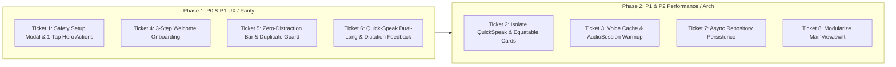

# iOS Optimization, Ease-of-Use & Android v1.7.4 Parity Tickets

### TL;DR
Audit of **Sotto-iOS** across three tracks: (1) **Performance & Zero-Lag Optimization** (eliminating keystroke-triggered grid re-renders, caching TTS voice scoring, pre-warming `AVAudioSession`, and backgrounding `UserDefaults` writes), (2) **Ease-of-Use & Zero-Distraction UX** (1-tap fullscreen button on the Emergency Hero Card, hiding administrative category controls outside Edit Mode, and surfacing dictation error feedback), and (3) **1:1 Android v1.7.4 Parity** (Guided Emergency Safety Card Setup modal and 3-Step Welcome Onboarding flow from Android commit `3a53ed4`). Structured into 8 prioritized "Go" tickets (`P0` $\to$ `P2`) with exact file paths, line numbers, telemetry requirements, and testable acceptance criteria.

---

## Part 1: Audit Findings Summary

### A) Performance & Latency Bottlenecks (iOS Runtime & SwiftUI Diffing)
1. **Full Grid Re-Evaluation on Every Quick-Speak Keystroke**:
   - In [`MainViewModel.swift`](../../Sotto/ViewModels/MainViewModel.swift#L31-L37), `@Published public var quickText: String` lives on the root `MainViewModel` alongside 17 other `@Published` properties.
   - Every character typed or dictated in [`QuickSpeakBarView.swift`](../../Sotto/Views/QuickSpeakBarView.swift#L58-L63) fires `MainViewModel.objectWillChange`, forcing [`MainView.phrasesContent(width:)`](../../Sotto/Views/MainView.swift#L862-L906) to recompute `viewModel.filteredPhrases` (`O(N)` array filter), rebuild `chunkPhrases(...)`, and re-evaluate every visible [`PhraseCardView`](../../Sotto/Views/PhraseCardView.swift#L3-L220).
2. **Uncached Voice Enumeration & Cold `AVAudioSession` Activation on Tap**:
   - In [`SpeechService.swift`](../../Sotto/Services/SpeechService.swift#L46-L69), every `speak(...)` invocation synchronously calls `AVAudioSession.sharedInstance().setCategory(...)` and `setActive(true)`, then iterates through all system voices in `AVSpeechSynthesisVoice.speechVoices()` via [`SpeechService.bestVoice(...)`](../../Sotto/Services/SpeechService.swift#L148-L215). On older hardware (such as A10 Fusion iPad 7th gen), this adds 50–150ms of main-thread latency before the first syllable is spoken.
3. **Synchronous Main-Thread `UserDefaults` JSON Serialization & `NLLanguageRecognizer` Allocation**:
   - [`UserDefaultsPhraseRepository.savePhrases(_:)`](../../Sotto/Data/PhraseRepository.swift#L166-L170) and [`UserDefaultsWhyFinderRepository.saveLogs(_:)`](../../Sotto/Data/WhyFinderRepository.swift#L169-L173) run `JSONEncoder().encode(...)` synchronously on the main thread during drag-and-drop card reordering ([`MainViewModel.movePhrase`](../../Sotto/ViewModels/MainViewModel.swift#L229-L250)).
   - [`LocaleHelper.detectPhraseLocale`](../../Sotto/Utils/LocaleHelper.swift#L195-L218) instantiates a fresh `NLLanguageRecognizer()` on every phrase resolution instead of reusing a single shared recognizer.

### B) Ease-of-Use & Android v1.7.4 Parity Gaps
1. **Unconfigured Emergency Safety Card Speaks Raw Template Instead of Guided Setup**:
   - In Android (`../Sotto` commit `3a53ed4` / [#70]), tapping an Emergency Safety Card that still contains bracket placeholders (`[Area/Neighborhood]`, `[phone number]`) opens `EmergencySafetySetupDialog.kt` (3 simple fields: Neighborhood/Area, Contact Name, Emergency Phone) and displays an *"Unconfigured — Tap to set up"* badge on the card.
   - In [`MainView.swift`](../../Sotto/Views/MainView.swift#L873-L879) and [`PhraseCardView.swift`](../../Sotto/Views/PhraseCardView.swift#L106-L158), tapping the default safety card speaks the incomplete sentence aloud without guiding the user to fill in their details.
2. **Missing 1-Tap Fullscreen & Speak Buttons on Emergency Hero Card**:
   - In Android (`SottoApp.kt` lines 1225–1250), the Emergency Hero Card header includes explicit 40pt 1-tap `Fullscreen` (`⛶`) and `Speak` (`🔊`) buttons so users in crisis do not need to discover the hidden 0.5s long-press gesture. [`PhraseCardView.swift`](../../Sotto/Views/PhraseCardView.swift#L108-L119) only renders the static `Safety` badge.
3. **Missing 3-Step First-Launch Welcome & Role Onboarding Flow**:
   - Android commit `3a53ed4` ([#70]) added `WelcomeOnboardingDialog.kt` (Step 1: Role selection `self` / `caregiver` / `professional`, Step 2: Guided Safety Card configuration, Step 3: Role-tailored quick-start guide). `Sotto-iOS` currently drops first-time users directly into the grid without role or safety card onboarding.
4. **Administrative `Manage Categories` Button Exposed Outside Edit Mode**:
   - In [`MainView.swift`](../../Sotto/Views/MainView.swift#L732-L753), the `Manage Categories` (`tune`) button is always visible on the category chip bar during active communication. Both [CONTRIBUTING.md](../../CONTRIBUTING.md#L16) (*"Zero-Distraction Communication: In active communication mode, administrative actions remain hidden"*) and Android (`SottoApp.kt` line 615) gate `Manage Categories` strictly behind `isEditMode`.
5. **Quick-Speak Fullscreen Dual-Language Gap & Silent Dictation Failures**:
   - In [`MainView.swift`](../../Sotto/Views/MainView.swift#L68-L77), expanding Quick-Speak text to Fullscreen does not attach dictionary/secondary translation when `showLanguageSwitcher` is enabled (unlike `SottoApp.kt` lines 818–834).
   - In [`QuickSpeakBarView.swift`](../../Sotto/Views/QuickSpeakBarView.swift#L11) and [`TwoWayConversationModal.swift`](../../Sotto/Views/TwoWayConversationModal.swift), `speechRecognizer.errorMessage` is never rendered when permissions are denied or offline speech models are missing.

---

## Part 2: Prioritized "Go" Tickets (8 Tickets)

```
[P0] Immediate crisis ease-of-use & guided safety setup parity
[P1] Zero-lag performance optimization & core Android v1.7.4 parity
[P2] Architecture modularity & low-stimulus polish
```

---

### Ticket 1: [UX][iOS] Guided Emergency Safety Card Setup Modal & 1-Tap Fullscreen Hero Actions
**Labels**: `UX`, `iOS`, `parity`, `accessibility`, `P0`  
**Priority**: P0 (Emergency readiness & 1-tap crisis usability)

#### Description
- **Problem**: New users have a default Emergency Safety Card with unresolved brackets (`"I live around [Area/Neighborhood], please call my emergency contact: [phone number]"`). Currently on iOS:
  1. Tapping the unconfigured card speaks the incomplete sentence aloud rather than helping the user configure their area and emergency contact.
  2. Showing the safety card fullscreen to a bystander requires a 500ms long-press, which is undiscoverable under stress or motor tremor.
- **Current**:
  - [`PhraseCardView.swift`](../../Sotto/Views/PhraseCardView.swift#L106-L158): Renders only the `Safety` badge and text; no unconfigured indicator and no 1-tap fullscreen button.
  - [`MainViewModel.swift`](../../Sotto/ViewModels/MainViewModel.swift#L370-L423): `speak(phrase:)` immediately speaks unconfigured emergency cards.
- **Expected**:
  - Port `EmergencySafetySetupDialog.kt` and `EmergencySafetyHelper.kt` (Android commit `3a53ed4` / [#70]):
    - Add `LocaleHelper.hasUnresolvedPlaceholders(_:)` and `LocaleHelper.formatSafetyPhrase(area:contactName:phone:appLanguage:)`.
    - When `phrase.isEmergency && LocaleHelper.hasUnresolvedPlaceholders(phrase.text)` is true, display an amber setup pill (`"Tap to set up your emergency contact & area"`) on the card, and intercept taps in non-edit mode to open `EmergencySafetySetupModal` (Neighborhood/Area, Contact Name, Emergency Phone).
    - Record opt-in telemetry via `UsabilityTracker.shared.recordActivation("safety_card_configured", voiceSettings: voiceSettings)`.
  - Add explicit 40×40pt 1-tap `Fullscreen` (`⛶`) and `Speak` (`🔊`) icon buttons on the top-right of the Emergency Hero Card in `PhraseCardView.swift` when `!isEditMode` (matching `SottoApp.kt` lines 1225–1250).
- **Android Parity**: Matches Android commit `3a53ed4` ([#70]) and `SottoApp.kt` lines 1089–1287.
- **Acceptance Criteria**:
  1. Unconfigured Emergency Safety Card displays a clear setup badge and opens the 3-field `EmergencySafetySetupModal` on tap.
  2. Saving area, contact name, and phone updates both `text` and digit-formatted `spokenText`, and records `safety_card_configured` telemetry when opted in.
  3. Configured Emergency Safety Card displays 1-tap Fullscreen (`⛶`) and Speak (`🔊`) buttons in the card header.

---

### Ticket 2: [PERF][iOS] Isolate Quick-Speak State & Equatable Phrase Cards to Eliminate Keystroke Grid Re-Renders
**Labels**: `perf`, `iOS`, `optimization`, `P1`  
**Priority**: P1 (UI responsiveness & battery efficiency)

#### Description
- **Problem**: Typing or dictating in `QuickSpeakBarView` mutates `viewModel.quickText` on every character, triggering `MainViewModel.objectWillChange`. Because `MainView` observes `MainViewModel`, every keystroke forces SwiftUI to recompute `viewModel.filteredPhrases`, re-chunk rows, and diff every `PhraseCardView` in the grid.
- **Current**:
  - [`MainViewModel.swift`](../../Sotto/ViewModels/MainViewModel.swift#L31-L69): `quickText` is a `@Published` property on `MainViewModel`, and `filteredPhrases` is an uncached computed property that runs `.filter` on every access.
  - [`PhraseCardView.swift`](../../Sotto/Views/PhraseCardView.swift#L3): Does not conform to `Equatable`.
- **Expected**:
  - Cache `filteredPhrases` in `MainViewModel` (updating only when `phrases`, `selectedCategory`, or `voiceSettings.showSafetyCards` changes) OR manage draft text locally inside `QuickSpeakBarView` and only notify `MainViewModel` on submit/save/clear.
  - Conform `PhraseCardView` to `Equatable` (comparing `phrase`, `isEditMode`, `showAlternateSpeech`, `appLanguage`, `cardLayout`) so unaffected cards skip body evaluation.
- **Impact**: Zero phrase-grid CPU work while typing or dictating in the Quick-Speak bar; smoother scrolling and lower battery consumption on older iPads.
- **Acceptance Criteria**:
  1. Typing in `QuickSpeakBarView` does not re-evaluate `PhraseCardView.body` or recompute `filteredPhrases`.
  2. `UsabilityTracker` `QuickSpeak` start/end/abort intents continue firing with 100% test parity.

---

### Ticket 3: [PERF][iOS] SpeechService Voice Lookup Caching & AudioSession Warmup for Sub-50ms Latency
**Labels**: `perf`, `iOS`, `speech`, `optimization`, `P1`  
**Priority**: P1 (First-syllable speech latency)

#### Description
- **Problem**: In AAC communication, every millisecond between tapping a card and hearing speech matters. Currently, every `SpeechService.speak(...)` call enumerates `AVSpeechSynthesisVoice.speechVoices()`, scores every voice on the system, and synchronously activates `AVAudioSession`.
- **Current**:
  - [`SpeechService.swift`](../../Sotto/Services/SpeechService.swift#L46-L69): Calls `AVAudioSession.sharedInstance().setCategory(...)` + `setActive(true)` and `SpeechService.bestVoice(...)` on every utterance.
  - [`LocaleHelper.swift`](../../Sotto/Utils/LocaleHelper.swift#L195-L218): Allocates a new `NLLanguageRecognizer()` on every `detectPhraseLocale` call.
- **Expected**:
  - Cache resolved `AVSpeechSynthesisVoice` instances in a dictionary keyed by `"\(languageCode)|\(preferredIdentifier ?? "")"`.
  - Track audio session activation state in `SpeechService` and pre-warm `AVAudioSession` on app launch/foreground so `speak(...)` only re-applies category when switching from recording (`.playAndRecord`) or `.ambient` chime mode.
  - Reuse a static/thread-safe `NLLanguageRecognizer` instance in `LocaleHelper`.
- **Impact**: Cuts 50–150ms of main-thread overhead prior to speech synthesis on physical devices.
- **Acceptance Criteria**:
  1. Repeated `SpeechService.bestVoice(...)` calls for the same language/identifier return cached voice in $O(1)$ time.
  2. Unit tests verify voice scoring and cached lookup parity.

---

### Ticket 4: [UX][iOS] 3-Step First-Launch Welcome & Role Onboarding Flow
**Labels**: `UX`, `iOS`, `parity`, `P1`  
**Priority**: P1 (First-time ease of use & 1:1 Android parity)

#### Description
- **Problem**: First-time users (caregivers in crisis vs. autistic self-advocates) open Sotto without guidance on the two core modes (Daily AAC Board vs. Partner Mode 180° Yes/No HUD) or emergency safety card setup.
- **Current**:
  - `Sotto-iOS` has no onboarding modal; `VoiceSettings.userRole` defaults to `"unset"` and is only asked 14 days later inside `PmfSurveyModal`.
- **Expected**:
  - Port `WelcomeOnboardingDialog.kt` (Android commit `3a53ed4` / [#70]) to `Sotto/Views/WelcomeOnboardingModal.swift`:
    - **Step 1 (Role & Intent)**: Select role (`Self-expression`, `Caregiver / Family`, `Therapist / Educator`), immediately advancing to Step 2 and recording `UsabilityTracker.shared.recordRoleSet(...)`.
    - **Step 2 (Emergency Safety Card Setup)**: Optional inline setup of Neighborhood/Area, Contact Name, and Emergency Phone (with *"Skip for later"* button).
    - **Step 3 (Ready Summary)**: Role-tailored summary highlighting Partner Mode (`🤝`) for caregivers or 1-tap Phrase Cards & Fullscreen for self-users.
  - Persist `hasCompletedOnboarding` in `VoiceSettingsRepository` and record `onboarding_started` / `onboarding_completed` via `UsabilityTracker`.
- **Android Parity**: Matches Android commit `3a53ed4` ([#70]).
- **Acceptance Criteria**:
  1. First launch presents the 3-step `WelcomeOnboardingModal` (skippable at any step).
  2. Completing or skipping sets `hasCompletedOnboarding = true` and persists the selected role.
  3. Demo automation mode (`--demo-en` / `--demo-id`) automatically bypasses onboarding so automated video recording scripts remain uninterrupted.

---

### Ticket 5: [UX][iOS] Zero-Distraction Category Bar & Duplicate Phrase Prevention Feedback
**Labels**: `UX`, `iOS`, `parity`, `P1`  
**Priority**: P1 (Zero-distraction compliance & error prevention)

#### Description
- **Problem**:
  1. The `Manage Categories` (`tune`) button is visible in the category filter row during normal communication mode, violating the Zero-Distraction Mode rule and differing from Android (`SottoApp.kt` line 615). Allows accidental taps during sensory distress.
  2. Tapping `+` (Save as phrase card) in `QuickSpeakBarView` when the phrase already exists opens `PhraseEditModal`, which silently refuses to save without explaining why.
- **Current**:
  - [`MainView.swift`](../../Sotto/Views/MainView.swift#L732-L753): Renders `Manage Categories` outside `if viewModel.isEditMode`.
  - [`MainView.swift`](../../Sotto/Views/MainView.swift#L78-L87) & [`PhraseEditModal.swift`](../../Sotto/Views/PhraseEditModal.swift): No user-facing duplicate phrase warning or `duplicate_phrase_blocked` friction telemetry.
- **Expected**:
  - Gate the `Manage Categories` chip inside `if viewModel.isEditMode` in `MainView.swift` (matching `SottoApp.kt` line 615).
  - When attempting to add/save a phrase whose text matches an existing phrase (case-insensitive), record `UsabilityTracker.shared.recordFriction("duplicate_phrase_blocked", voiceSettings: voiceSettings)` and display an inline warning/alert (*"This phrase already exists"*).
- **Android Parity**: Matches Android commits `e335c72` and `69f8198` ([#66]).
- **Acceptance Criteria**:
  1. In normal communication mode (`isEditMode == false`), only category filter chips are shown—zero administrative buttons (`Manage Categories` or `Add`).
  2. Entering Edit Mode reveals `Manage Categories` and `+ Add`.
  3. Attempting to save a duplicate phrase alerts the user and logs `duplicate_phrase_blocked` when telemetry is enabled.

---

### Ticket 6: [UX][iOS] Quick-Speak Fullscreen Dual-Language Translation & Dictation Error Feedback
**Labels**: `UX`, `iOS`, `speech`, `parity`, `P1`  
**Priority**: P1 (Bilingual communication & dictation reliability)

#### Description
- **Problem**:
  1. When Dual-Language Switcher (`EN | ID`) is enabled and a user types in `QuickSpeakBarView` and taps Fullscreen (`⛶`), `MainView` creates a `Phrase` without populating `spokenText`/`spokenLanguage`, so the fullscreen card lacks dual-language speech/subtitle support.
  2. When offline speech recognition fails or microphone permission is denied in `QuickSpeakBarView` or `TwoWayConversationModal`, `SpeechRecognizerService.errorMessage` is set but never displayed in the UI.
- **Current**:
  - [`MainView.swift`](../../Sotto/Views/MainView.swift#L68-L77): Creates `Phrase(text: text, language: LocaleHelper.langAuto)` with `spokenText: nil`.
  - [`QuickSpeakBarView.swift`](../../Sotto/Views/QuickSpeakBarView.swift#L11) & [`TwoWayConversationModal.swift`](../../Sotto/Views/TwoWayConversationModal.swift): Do not observe or surface `speechRecognizer.errorMessage`.
- **Expected**:
  - When `viewModel.voiceSettings.showLanguageSwitcher` is true, resolve dictionary translation via `TranslationHelper.dictionaryTranslation(...)` when opening Quick-Speak Fullscreen so both primary and secondary languages are available in `FullscreenPhraseModal` (matching `SottoApp.kt` lines 818–834).
  - Display a subtle, dismissible banner or alert when `speechRecognizer.errorMessage` is non-nil (with guidance to enable Microphone/Speech permissions or download offline dictation in iOS Settings), and record `UsabilityTracker.shared.recordFriction("speech_error", ...)`.
- **Android Parity**: Matches `SottoApp.kt` lines 818–834 and Android commit `f4f1757` ([#63]).
- **Acceptance Criteria**:
  1. Expanding a Quick-Speak phrase to Fullscreen with Language Switcher enabled populates translated `spokenText` when available.
  2. Denied microphone permission or unavailable offline dictation shows a clear, actionable message instead of failing silently.

---

### Ticket 7: [PERF][iOS] Asynchronous Background Persistence for Phrase & Log Repositories
**Labels**: `perf`, `iOS`, `optimization`, `P2`  
**Priority**: P2 (Smooth 60/120Hz drag-and-drop animations)

#### Description
- **Problem**: Reordering cards via drag-and-drop calls `MainViewModel.movePhrase`, which synchronously encodes the entire `[Phrase]` array to JSON and writes to `UserDefaults` on the main thread during the drop animation.
- **Current**:
  - [`PhraseRepository.swift`](../../Sotto/Data/PhraseRepository.swift#L166-L170) & [`WhyFinderRepository.swift`](../../Sotto/Data/WhyFinderRepository.swift#L169-L173): Synchronous `JSONEncoder().encode(...)` on the caller thread.
- **Expected**:
  - Keep in-memory state synchronous in `MainViewModel` while coalescing/dispatching `JSONEncoder().encode(...)` + `UserDefaults` writes on a serial background queue (with synchronous flush support for unit tests).
- **Acceptance Criteria**:
  1. Drag-and-drop card reordering performs zero `JSONEncoder` work on the main thread.
  2. All repository unit tests in `SottoTests.swift` pass without race conditions.

---

### Ticket 8: [ARCH][iOS] Modularize MainView.swift into Focused Subviews
**Labels**: `architecture`, `iOS`, `maintainability`, `P2`  
**Priority**: P2 (Code simplicity & SwiftUI diffing efficiency)

#### Description
- **Problem**: [`MainView.swift`](../../Sotto/Views/MainView.swift) has grown to 1,048 lines containing the top bar, category chip bar, persistent safety banner, adaptive grid, drag-and-drop delegate, and 11 modal sheets.
- **Expected**:
  - Extract cohesive, self-contained components (`MainTopBarView`, `CategoryFilterBarView`, `ReorderablePhraseCard`) while preserving 100% identical visual styling, `.demoTarget(...)` identifiers, and accessibility modifiers.
  - Run `xcodegen generate` and verify build and unit tests pass.
- **Acceptance Criteria**:
  1. `MainView.swift` is reduced by $>35\%$ in line count with cleaner subview boundaries.
  2. Zero visual, accessibility, or demo automation regressions.

---

## Part 3: Execution Roadmap



---

## Part 4: Implementation & Resolution Matrix

| Ticket | GitHub Issue | Priority | Status | Key Modified / Created Files |
| :--- | :--- | :---: | :---: | :--- |
| **Ticket 1**: Guided Emergency Safety Card Setup Modal & 1-Tap Fullscreen Hero Actions | [#55](https://github.com/triton1502oc/Sotto-iOS/issues/55) | `P0` | ✅ Resolved | [`EmergencySafetySetupModal.swift`](../../Sotto/Views/EmergencySafetySetupModal.swift), [`PhraseCardView.swift`](../../Sotto/Views/PhraseCardView.swift), [`LocaleHelper.swift`](../../Sotto/Utils/LocaleHelper.swift), [`MainViewModel.swift`](../../Sotto/ViewModels/MainViewModel.swift) |
| **Ticket 2**: Isolate Quick-Speak State & Equatable Phrase Cards | [#56](https://github.com/triton1502oc/Sotto-iOS/issues/56) | `P1` | ✅ Resolved | [`QuickSpeakBarView.swift`](../../Sotto/Views/QuickSpeakBarView.swift), [`PhraseCardView.swift`](../../Sotto/Views/PhraseCardView.swift), [`MainSubViews.swift`](../../Sotto/Views/MainSubViews.swift) |
| **Ticket 3**: SpeechService Voice Lookup Caching & AudioSession Warmup | [#57](https://github.com/triton1502oc/Sotto-iOS/issues/57) | `P1` | ✅ Resolved | [`SpeechService.swift`](../../Sotto/Services/SpeechService.swift), [`LocaleHelper.swift`](../../Sotto/Utils/LocaleHelper.swift), [`MainViewModel.swift`](../../Sotto/ViewModels/MainViewModel.swift) |
| **Ticket 4**: 3-Step First-Launch Welcome & Role Onboarding Flow | [#58](https://github.com/triton1502oc/Sotto-iOS/issues/58) | `P1` | ✅ Resolved | [`WelcomeOnboardingModal.swift`](../../Sotto/Views/WelcomeOnboardingModal.swift), [`MainView.swift`](../../Sotto/Views/MainView.swift), [`MainViewModel.swift`](../../Sotto/ViewModels/MainViewModel.swift) |
| **Ticket 5**: Zero-Distraction Category Bar & Duplicate Phrase Prevention | [#59](https://github.com/triton1502oc/Sotto-iOS/issues/59) | `P1` | ✅ Resolved | [`MainSubViews.swift`](../../Sotto/Views/MainSubViews.swift), [`MainView.swift`](../../Sotto/Views/MainView.swift), [`MainViewModel.swift`](../../Sotto/ViewModels/MainViewModel.swift), [`UsabilityTracker.swift`](../../Sotto/Services/UsabilityTracker.swift) |
| **Ticket 6**: Quick-Speak Fullscreen Dual-Language Translation & Dictation Error Feedback | [#60](https://github.com/triton1502oc/Sotto-iOS/issues/60) | `P1` | ✅ Resolved | [`MainView.swift`](../../Sotto/Views/MainView.swift), [`QuickSpeakBarView.swift`](../../Sotto/Views/QuickSpeakBarView.swift), [`TwoWayConversationModal.swift`](../../Sotto/Views/TwoWayConversationModal.swift), [`PhraseEditModal.swift`](../../Sotto/Views/PhraseEditModal.swift) |
| **Ticket 7**: Asynchronous Background Persistence for Phrase & Log Repositories | [#61](https://github.com/triton1502oc/Sotto-iOS/issues/61) | `P2` | ✅ Resolved | [`PhraseRepository.swift`](../../Sotto/Data/PhraseRepository.swift), [`WhyFinderRepository.swift`](../../Sotto/Data/WhyFinderRepository.swift) |
| **Ticket 8**: Modularize MainView.swift into Focused Subviews | [#62](https://github.com/triton1502oc/Sotto-iOS/issues/62) | `P2` | ✅ Resolved | [`MainSubViews.swift`](../../Sotto/Views/MainSubViews.swift), [`MainView.swift`](../../Sotto/Views/MainView.swift) (reduced from 1,048 lines to 596 lines, $-43\%$) |
