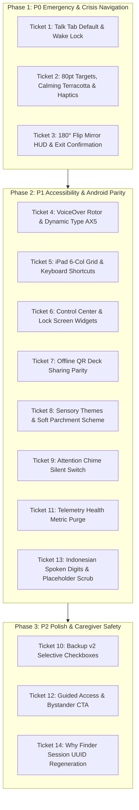

# iOS UX Expert Audit & Android Feature Parity Tickets

### TL;DR
Comprehensive assistive tech UX audit and Android feature parity review for **Sotto-iOS** (v1.7.2 baseline, matching Android v1.7.4). Grounded in real-world crisis use (father SG caring for sons 22 & 15 during acute meltdowns and speech shutdowns). Identifies critical crisis navigation gaps, accessibility bottlenecks under VoiceOver / Dynamic Type AX5, sensory theme compliance, telemetry privacy leaks (`bodyPart`/`intensity`), and missing system integrations (iOS Control Center widget / Lock Screen / Screen Wake Lock). Outlines 14 structured, prioritized tickets (P0 $\to$ P1 $\to$ P2) with exact code lines and testable acceptance criteria before code implementation.

---

## Part 1: Full iOS Codebase UX & Accessibility Audit

### A) Emergency & Partner Mode (CRITICAL)
- **Talk Tab vs. Why Finder Default**:
  - `Sotto/Views/TwoWayConversationModal.swift` (line 31) defaults `@State private var activeTab: CaregiverTab = .freeform`, but tab preference is not persisted across launches. If the user previously used Guided Mode or if deep links trigger without arguments, there is no guarantee that Talk Mode opens first.
  - In Android commit `ca79b17` ([#73]) and `7de2c4b` ([#68]), the Quick Settings crisis shortcut routes **strictly and directly to Talk Mode**, and tab preference is remembered in `UserDefaults`.
- **Target Sizes & Accessibility Traits**:
  - `TwoWayConversationModal.swift` (lines 876–915): Primary Yes/No buttons enforce 80–92pt frame height, but **completely lack `.accessibilityAddTraits(.isButton)`** and descriptive `.accessibilityHint` values.
  - Secondary response cards (Wait, Repeat, Not Sure, Stop) in lines 918–992 are only 54pt high, which is insufficient for shaky motor tremors during sensory meltdowns.
  - Alarming red container `SottoTheme.crisisStopContainer` (`#7F1D1D`) in line 911 triggers sensory alarm; Android commit `7816fa1` ([#72]) replaced this with a calming, WCAG AAA compliant terracotta container (`#5A3030`, text `#FBEBE8`).
- **180° Flip & Screen Wake Lock**:
  - `TwoWayConversationModal.swift` (lines 166–180): On iPhone, flipping locks orientation to portrait and rotates inner content by 180°. On iPad, orientation is free.
  - **Missing Screen Wake Lock**: iOS does not set `UIApplication.shared.isIdleTimerDisabled = true`. During a severe meltdown lasting 3–8 minutes, the device can dim and lock mid-crisis, breaking the non-speaking user's connection.
  - **Missing Upright Caregiver Mirror HUD**: When flipped 180°, the caregiver facing the bottom of the device has no glanceable view of the prompt or response depth that the individual is looking at (introduced in Android commit `7de2c4b` / [#68]).
- **Safety Card Fullscreen & Spoken Digit Pronunciation**:
  - `Sotto/Views/FullscreenPhraseModal.swift` (line 60): Background uses `#1E1710` instead of `#251E14` (`SottoTheme.emergencyBackground`).
  - `Sotto/Utils/LocaleHelper.swift` (lines 293–323) & `Sotto/Services/SpeechService.swift` (line 49): `formatDigitsForSpeech` only inserts spaces (`0 8 1 2`). When Indonesian TTS (Damayanti/Siri) reads phone numbers, `0812` is frequently mispronounced as a calendar date ("8 Desember") or a single large integer. Android commit `28a45de` and `EmergencySafetyHelper.kt` convert digits to Indonesian spoken words (`nol`, `satu`, `dua`, `tiga`...) with 4-digit pause grouping.
  - Unresolved bracket placeholders (e.g. `[Area/Neighborhood]`, `[Phone Number]`) are not stripped before TTS, causing speech synthesizers to speak literal square brackets aloud.
- **Attention Chime (D5 $\to$ A5)**:
  - `Sotto/Services/ChimePlayer.swift` (lines 22–57): Correctly synthesizes D5 (587.33 Hz, 90ms) and A5 (880.00 Hz, 160ms + 2nd harmonic 1760Hz at 20% amplitude + exponential decay).
  - Line 120 sets `AVAudioSession` category to `.playback`, which ignores the hardware Ring/Silent switch. Line 107 triggers haptics unconditionally without checking `UIAccessibility.isReduceMotionEnabled`.

### B) Self-Expression Board
- **Adaptive Grid**:
  - `Sotto/Views/MainView.swift` (line 831): `let columnsCount = width >= 900 ? 4 : (width >= 600 ? 3 : 2)`. On 11" and 12.9" iPad Pro models in landscape (width > 1100pt), cards are clamped to 4 columns, resulting in overly wide, stretched cards. In Split View / Slide Over (320pt width), 2 columns squish text. Needs adaptive column sizing up to 6 columns on large iPad screens.
- **Dynamic Type AX1–AX5 Truncation**:
  - `Sotto/Views/PhraseCardView.swift` (line 165, 185): Strict aspect ratio `.aspectRatio(isCompact ? 1.25 : 1.0, contentMode: .fit)` and fixed `lineLimit(2..4)` force cards to maintain fixed proportions. Under Dynamic Type AX1–AX5, large accessibility text causes severe clipping and ellipsis truncation.
- **QuickSpeakBar Multi-line & Hardware Keyboard**:
  - `Sotto/Views/QuickSpeakBarView.swift` (line 64): Supports 1–4 lines via `TextField(..., axis: .vertical)`. However, hardware keyboard shortcuts (`Cmd + Return` to speak, `Esc` to clear) and `.hoverEffect()` are missing for iPad Magic Keyboard and trackpad users.

### C) Themes & Sensory
- **5 Sensory Themes & System Color Scheme**:
  - `Sotto/Theme/Theme.swift`: All 5 themes (Charcoal, OLED Pure Black, Warm Amber, Slate Navy, Soft Parchment) have verified contrast tokens.
  - `Sotto/SottoApp.swift` (line 30): `.preferredColorScheme(.dark)` is hardcoded globally on `MainView()`. When the user selects "Soft Parchment" (anti-halation daylight light theme), sheets and status bar still inherit forced dark mode or clash.
- **Accessibility System Preferences**:
  - Lacks observation of `accessibilityReduceTransparency` (e.g. `CaregiverBottomMenu` uses `opacity(0.92)`).
  - Lacks observation of `accessibilityDifferentiateWithoutColor` to ensure high-contrast borders and symbols exist when color perception is impaired.

### D) Speech & Voice
- **SpeechService Voice Scoring**:
  - `Sotto/Services/SpeechService.swift` (lines 89–146): Successfully scores Siri (+150), Samantha (+120), Damayanti (+120), Ava (+100) and penalizes 21 novelty voices (-5000).
- **On-Device Speech Recognition Fallback**:
  - `Sotto/Services/SpeechRecognizerService.swift` (line 75): Enforces `requiresOnDeviceRecognition = true`. However, when offline recognition models are not downloaded or fail, errors are silently captured in `@Published var errorMessage` which is never rendered in `TwoWayConversationModal.swift`, leaving caregivers unaware of why transcription stopped.

### E) Privacy, Backup & QR
- **100% Offline Core**:
  - Zero URLSession calls in core speech, phrase storage, or crisis flow.
  - Zero third-party SDKs (no Firebase, no telemetry vendors).
- **CRITICAL TELEMETRY PRIVACY LEAK**:
  - `Sotto/Services/UsabilityTracker.swift` (line 332):
    ```swift
    contextTag: "area_\(safeArea)_d\(depth)_ns\(notSureCount)_bp_\(safePart)_int_\(safeIntensity)"
    ```
    Health-adjacent metrics (`bodyPart` and pain `intensity`) are **still being included** in the telemetry context tag in iOS.
    In Android commit `b2f4b7c` ([#71]), Android explicitly **purged** `bodyPart` and `intensity` from all telemetry payloads to safeguard offline privacy.
  - Pre-consent preview: In `Sotto/Views/VoiceSettingsModal.swift` (line 834), "View Shared Data Preview" is only shown *after* toggling metrics on. Android allows inspection *prior* to opting in.
- **QR Sharing Offline Parity**:
  - `Sotto/Services/PhraseBackupHelper.swift`: `SOTTO:v1:<base64>` format is 100% compatible between iOS and Android. Optical scanning functions in airplane mode.

### F) iOS Native Accessibility & System Integration
- VoiceOver: Missing custom accessibility Rotors to jump between categories or directly to Emergency cards.
- Control Center & Lock Screen: Missing iOS 18 ControlWidget and Lock Screen widget for sub-2.5s emergency launch to match Android Quick Settings Tile (`EmergencyTileService`).
- Guided Access: App does not detect `UIAccessibility.isGuidedAccessEnabled` to safeguard against accidental dismissal during crises.

---

## Part 2: Android Parity Audit (Last 30 Commits Cross-Reference)

| Android Commit | Android Feature / Fix | iOS Status | Parity Gap / Action Required |
|---|---|---|---|
| `ca79b17` / [#73] | Direct Crisis Shortcut to Talk Mode from Quick Settings | Missing | iOS App Shortcuts exist, but widget/routing doesn't force Talk tab. |
| `bb88cf4` / `844dba8` | Release maintenance & build bumps | Aligned | v1.7.2 tag and build 10 aligned. |
| `e335c72` / [#69] | Top bar partner mode squircle hero badge, reclaim 44dp | Missing | iOS uses small icon button; top bar can be streamlined. |
| `3a53ed4` / [#70] | 3-step welcome flow & guided emergency card setup | Missing | iOS opens directly into main grid; no guided safety setup. |
| `5c877ff` / [#69] | Hero partner mode entry & QS tile discovery prompt | Missing | iOS lacks Control Center discovery prompt for crisis tile. |
| `7de2c4b` / [#68] | Screen wake lock, upright caregiver mirror HUD, exit confirm | Missing | **Critical**: iOS has no wake lock, no mirror HUD, and no exit confirm. |
| `7816fa1` / [#72] | Harmonize tactile response dock (Wait/Not Sure/Stop) & terracotta `#5A3030` | Missing | **Critical**: iOS uses alarming red `#7F1D1D` and lacks unified secondary dock. |
| `b2f4b7c` / [#71] | Sanitize WhyFinder telemetry (purge `bodyPart`/`intensity`), pre-consent preview | Missing | **Critical Privacy**: iOS still sends `bp_` and `int_` in context tag. |
| `e8cf4b9` / [#67] | Regenerate session ID on restart, upsert logs | Missing | iOS Why Finder session restart does not generate new session UUID. |
| `69f8198` / [#66] | Prevent duplicate phrase grid crash across dialogs/imports | Partially Aligned | Deduplication exists in `mergeData`, but needs case-insensitive check in Add dialog. |
| `7e400c6` / [#65] | Default to compact rectangular card layout (1.25:1) | Aligned | Supported in `PhraseCardView.swift` via `VoiceSettings.cardLayout`. |
| `f4f1757` / [#63] | Graceful 3-tier speech fallback & offline model guidance | Missing | iOS speech recognizer silently fails without user guidance. |
| `28a45de` / [#40] | Indonesian spoken digit words (`nol`, `satu`...) & natural grouping | Missing | iOS inserts spaces between numbers instead of Indonesian digit words. |
| `98bf909` / [#40] | Direct Yes/No 80dp cards, emergency tile, medical terminology scrub | Aligned | Core 80pt Yes/No present, but missing accessibility traits. |

---

## Part 3: Prioritized Action Tickets (14 Tickets)

```
[P0] Stops meltdown / blocks App Store accessibility compliance
[P1] Assistive accessibility, core parity, and sensory compliance
[P2] Polish, guided access, and low-stimulus enhancements
```

---

### Ticket 1: [UX][iOS] Emergency TwoWayConversationModal Defaults to Talk Tab with Giant Yes/No Dock
**Labels**: `UX`, `iOS`, `accessibility`, `parity`, `P0`  
**Priority**: P0 (Stops meltdown)

#### Description
- **Problem**: During an acute sensory meltdown or shutdown, an autistic teenager or adult experiences intense cognitive overload, selective mutism, or flight/fight response. If the app presents a multi-level branching question tree ("Why Finder"), the user cannot navigate complex hierarchical logic, causing severe anxiety escalation and worsening the meltdown.
- **Current**: In `Sotto/Views/TwoWayConversationModal.swift`:
  - Line 31: `@State private var activeTab: CaregiverTab = .freeform` (defaults to freeform in the initial state, but does not persist tab preference across app restarts).
  - In `Sotto/Services/SottoShortcuts.swift` (line 43) and `Sotto/ViewModels/MainViewModel.swift` (line 436): Triggering Partner Mode via App Intent or URL scheme (`sotto://partner`) does not explicitly enforce Talk tab routing.
  - Active screen wake lock is absent; the screen dims and turns off during quiet waiting periods.
- **Expected**:
  - `TwoWayConversationModal` must ALWAYS explicitly prioritize and default to the Talk tab with the giant Yes/No dock.
  - Remember tab preference in `UserDefaults` (`partner_mode_last_tab`), defaulting to `.freeform`.
  - When opened via Emergency App Shortcuts, Action Button, Control Center, or deep link `sotto://partner`, enforce `activeTab = .freeform`.
  - Enable screen wake lock (`UIApplication.shared.isIdleTimerDisabled = true`) upon modal presentation, and restore upon dismissal.
- **Impact**: Validated real-world quote from father SG:
  > *"Direct card with yes/no does help.. i pinpoint the problem, issue resolved, no more meltdown" - Why Finder tree ZERO use during acute meltdown, now post-crisis explorer.*
- **iOS Enhancement**: `@AccessibilityFocusState` automatically focuses on the prompt area; `UIApplication.shared.isIdleTimerDisabled = true` prevents screen lock.
- **Android Parity**: Matches Android commit `ca79b17` ([#73]) and `7de2c4b` ([#68]).
- **Acceptance Criteria**:
  1. Launching Partner Mode from any entry point (top bar button, Action Button, deep link) opens directly to the Talk tab with the giant Yes/No dock in $<2.5\text{s}$.
  2. Switching tabs persists the selection in `UserDefaults`; subsequent launches open to the remembered tab unless triggered via emergency shortcut.
  3. Screen does not sleep or dim while Partner Mode is active on screen.
  4. Closing Partner Mode restores `isIdleTimerDisabled = false`.

---

### Ticket 2: [UX][iOS] Tactile Crisis Targets: Enforce 80pt+ Frame Height, Heavy Haptics, Calming Terracotta Palette, and Accessibility Traits
**Labels**: `UX`, `iOS`, `accessibility`, `parity`, `P0`  
**Priority**: P0 (Stops meltdown / motor tremor accessibility)

#### Description
- **Problem**: Fine motor coordination degrades severely during tremors and sensory meltdowns. Autistic individuals or caregivers operating with one hand easily mis-tap small buttons. Furthermore, VoiceOver, Switch Control, and Voice Control users encounter missing `.isButton` traits and hints, while the aggressive red `#7F1D1D` background triggers sensory panic.
- **Current**: In `Sotto/Views/TwoWayConversationModal.swift`:
  - Lines 876–915: Yes/No buttons are 80–92pt, but miss `.accessibilityAddTraits(.isButton)` (lines 895, 914).
  - Line 911 uses alarming red `SottoTheme.crisisStopContainer` (`#7F1D1D`) for "No".
  - Lines 918–992: Secondary buttons (Wait, Repeat, Not Sure, Stop) are only 54pt high and lack unified parity with Android.
- **Expected**:
  - Replace `#7F1D1D` with calming, WCAG AAA compliant terracotta container `Color(hex: 0x5A3030)` and text `Color(hex: 0xFBEBE8)` for "No".
  - Enforce `minHeight >= 80pt` with 20pt rounded corner radius for Yes/No buttons.
  - Unify Row 2 across both Guided and Talk modes to provide 3 tactile response cards: `Wait`, `Not Sure`, and `Stop` with minimum 54pt height, crisp vector icons, and distinct tactile haptics (`UIImpactFeedbackGenerator(style: .medium)`).
  - Add explicit `.accessibilityAddTraits(.isButton)` and actionable hints:
    - Yes: *"Double tap to confirm yes"*
    - No: *"Double tap to say no"*
    - Wait: *"Double tap to request a moment to pause"*
- **Impact**: Eliminates mis-taps during hand tremors and replaces alarming red with a dignified, calming terracotta tone.
- **iOS Enhancement**: Full Switch Control and Voice Control target numbering support.
- **Android Parity**: Matches Android commit `7816fa1` ([#72]) and `98bf909` ([#40]).
- **Acceptance Criteria**:
  1. Primary Yes and No touch targets are $\ge 80\text{pt}$ height with 20pt corner radii and heavy haptic feedback on touch down.
  2. "No" card container is rendered in terracotta `#5A3030` with high-contrast text `#FBEBE8` (contrast ratio $>7:1$, WCAG AAA).
  3. VoiceOver announces Yes as *"Yes, button. Double tap to confirm yes"*.
  4. Row 2 provides `Wait`, `Not Sure`, and `Stop` with accessible labels, icons, and medium haptic feedback.

---

### Ticket 3: [UX][iOS] 180° Flip: Upright Caregiver Mirror HUD, Exit Confirmation, and Table Mode
**Labels**: `UX`, `iOS`, `accessibility`, `parity`, `P0`  
**Priority**: P0 (Caregiver-operated crisis flow)

#### Description
- **Problem**: When a caregiver places the iPhone/iPad flat on a table between themselves and the autistic individual and flips the display 180°, the caregiver at the bottom cannot read what prompt or response the individual is looking at without awkwardly leaning over or turning the device around. Furthermore, hitting the close button accidentally terminates active check-in sessions instantly without confirmation.
- **Current**: In `Sotto/Views/TwoWayConversationModal.swift`:
  - Lines 275–277: Rotates the patient display 180° facing across the table, but provides no upright status bar for the caregiver.
  - Line 1369: Standalone modal dismissal button closes immediately without verifying if an active check-in is in progress.
- **Expected**:
  - Add an **Upright Caregiver Mirror HUD** directly above the bottom menu when flipped 180°: displays the current prompt text in miniature (upright orientation facing the caregiver), active session depth, and the last selected response.
  - Add **Exit Confirmation Alert**: If a check-in session is actively in progress, tapping dismiss (`✕`) presents an alert: *"Exit Partner Mode? An active check-in is in progress. Do you want to exit? Your session will be saved as stopped."*
  - Support iPad free rotation and iPhone table mode without locking out intentional physical orientation.
- **Impact**: Enables seamless, non-intrusive caregiver monitoring across tables and prevents accidental dismissals during sensory crises.
- **iOS Enhancement**: Integrated SwiftUI alert and smooth spring transition for mirror HUD.
- **Android Parity**: Matches Android commit `7de2c4b` ([#68]).
- **Acceptance Criteria**:
  1. When flipped 180°, an upright caregiver mirror HUD appears at the bottom facing the caregiver, showing prompt text and response status.
  2. Tapping dismiss while in an active check-in displays confirmation alert before exiting.
  3. Confirming exit marks the Why Finder session as `.stopped` in `WhyLog`.

---

### Ticket 4: [UX][iOS] Accessibility: VoiceOver Rotor, Focus Management & Dynamic Type AX1–AX5 Audit
**Labels**: `UX`, `iOS`, `accessibility`, `P1`  
**Priority**: P1 (App Store accessibility & zero-truncation guarantee)

#### Description
- **Problem**: Users relying on Dynamic Type accessibility sizes (AX1 through AX5) experience severe text clipping on phrase cards due to hardcoded `.aspectRatio` clamping. VoiceOver users cannot quickly navigate between categories or jump directly to the Emergency safety card because custom Accessibility Rotors are missing.
- **Current**:
  - `Sotto/Views/PhraseCardView.swift` (line 165, 185): Clamped by `.aspectRatio(isCompact ? 1.25 : 1.0, contentMode: .fit)` and `lineLimit(2..4)`.
  - `Sotto/Views/MainView.swift`: Phrases grid does not implement `.accessibilityRotor`.
- **Expected**:
  - When Dynamic Type is in an accessibility category (`@Environment(\.sizeCategory)` $\ge$ `.accessibilityMedium`), relax the strict aspect ratio to allow cards to grow vertically without text clipping.
  - Implement a custom Accessibility Rotor for **"Categories"** and **"Emergency / Safety"** allowing VoiceOver users to flick between sections.
  - In `TwoWayConversationModal`, use `@AccessibilityFocusState` to move focus immediately to the prompt text upon question change.
- **Impact**: Guarantees zero truncation for low-vision users and rapid rotor navigation for non-speaking VoiceOver users.
- **Acceptance Criteria**:
  1. Under Dynamic Type AX5 (maximum iOS text size), phrase card text displays completely without ellipsis (`...`) truncation.
  2. VoiceOver Rotor contains "Categories" and "Safety Cards" options.
  3. Question transitions in Partner Mode immediately focus VoiceOver on the new prompt.

---

### Ticket 5: [UX][iOS] iPad Large-Screen Optimization: Adaptive Grid (up to 6 Columns), Stage Manager, and Keyboard Shortcuts
**Labels**: `UX`, `iOS`, `accessibility`, `parity`, `P1`  
**Priority**: P1 (Tablet & assistive mount parity)

#### Description
- **Problem**: On large iPad screens (11" and 12.9" iPad Pro) mounted to wheelchairs or desks, phrase cards are restricted to a maximum of 4 columns, stretching cards into unnaturally wide bars. In Split View (320pt width), 2 columns squish content. Furthermore, hardware keyboard users cannot trigger speech via keyboard shortcuts.
- **Current**: In `Sotto/Views/MainView.swift` (line 831):
  ```swift
  let columnsCount = width >= 900 ? 4 : (width >= 600 ? 3 : 2)
  ```
  Lacks keyboard shortcuts in `QuickSpeakBarView.swift` and lacks `.hoverEffect()` for trackpad/mouse pointer interaction.
- **Expected**:
  - Dynamically calculate columns based on responsive minimum target width:
    - Width $< 380\text{pt}$ (Split View / Compact): 2 columns
    - Width $380\text{–}650\text{pt}$: 3 columns
    - Width $650\text{–}950\text{pt}$: 4 columns
    - Width $950\text{–}1200\text{pt}$: 5 columns
    - Width $\ge 1200\text{pt}$ (iPad Pro Landscape / Stage Manager): 6 columns
  - Add hardware keyboard shortcuts:
    - `Cmd + Return`: Speak text in QuickSpeakBar
    - `Esc`: Clear QuickSpeakBar
    - `Cmd + 1..5`: Switch theme
  - Add `.hoverEffect(.highlight)` to cards and buttons for pointer and assistive head-pointer devices.
- **Impact**: Optimizes communication displays for wheelchair-mounted iPads and rapid desktop/keyboard communication.
- **Acceptance Criteria**:
  1. iPad Pro 12.9" in full-screen landscape renders 6 columns of comfortable, unclipped rectangular phrase cards.
  2. Pressing `Cmd + Return` on an external keyboard speaks QuickSpeak text immediately.
  3. Trackpad pointer snaps to cards with smooth system hover effects.

---

### Ticket 6: [UX][iOS] Sub-2.5s Crisis Access: Control Center Widget, Lock Screen Widget & Top Bar Hero Entry
**Labels**: `UX`, `iOS`, `parity`, `P1`  
**Priority**: P1 (Crisis speed parity with Android Quick Settings Tile)

#### Description
- **Problem**: Android has a dedicated Quick Settings shade tile (`EmergencyTileService`) providing sub-3-second direct access to Partner Mode from anywhere, even with the device locked. On iOS, opening the app and finding the small partner mode button takes 5–8 seconds during an emergency.
- **Current**:
  - `Sotto/Services/SottoShortcuts.swift` provides `AppShortcut` for Siri and Action Button, but lacks an iOS 18 Control Center ControlWidget and Lock Screen accessory widget.
  - `Sotto/Views/MainView.swift` (line 563): Partner Mode is represented by a 44x44 icon button in the top bar rather than a prominent hero entry.
- **Expected**:
  - Implement an iOS 18 Control Center `ControlWidget` (`SottoPartnerControlWidget`) launching directly into Partner Mode via `OpenEmergencyPartnerIntent`.
  - Implement a Lock Screen Circular and Rectangular widget for rapid 1-tap crisis launch from the iOS Lock Screen.
  - Upgrade the top bar entry in `MainView.swift` to a prominent high-visibility squircle badge labeled **"Partner Mode"** (matching Android commit `5c877ff` / [#69]).
- **Impact**: Caregiver can access binary check-in from the Lock Screen or Control Center in under 2.5 seconds without unlocking or navigating the home screen.
- **Android Parity**: Matches Android commit `5c877ff` ([#69]) and `ca79b17` ([#73]).
- **Acceptance Criteria**:
  1. Caregiver can tap Sotto Partner in iOS Control Center or Lock Screen to launch directly into Partner Mode Talk tab in $<2.5\text{s}$.
  2. Top bar features a prominent high-contrast Partner Mode entry pill.

---

### Ticket 7: [UX][iOS] Offline QR Deck Sharing Parity & Airplane Mode Verification
**Labels**: `UX`, `iOS`, `parity`, `P1`  
**Priority**: P1 (100% offline cross-platform parity)

#### Description
- **Problem**: Caregivers and speech therapists frequently transfer personalized vocabulary decks between Android and iOS devices in environments without cellular data or Wi-Fi (e.g. clinical rooms, airplanes, special education classrooms). If QR generation exceeds payload limits or scanner camera fails, sharing fails.
- **Current**:
  - `Sotto/Views/QRCodeModal.swift` (line 36): If data exceeds 2800 bytes, QR generation fails and displays a static error without guidance.
  - `Sotto/Views/QRScannerModal.swift` (line 99): Camera scanner preview works, but fallback manual paste does not auto-detect `SOTTO:v1:` payloads on appearance.
- **Expected**:
  - Ensure `PhraseBackupHelper.exportCompactPhrasesForQR` continues to strip bulky logs and question trees, keeping payloads $\le 2\text{KB}$.
  - When clipboard contains a valid `SOTTO:v1:` deck upon opening `QRScannerModal`, display an instant 1-tap "Import Deck from Clipboard" prompt.
  - Verify complete cross-platform offline importing: Android generated QR $\to$ iOS scanner, and iOS generated QR $\to$ Android scanner in Airplane Mode.
- **Impact**: Guarantees zero-cloud, 100% private offline sharing between families and therapists across operating systems.
- **Acceptance Criteria**:
  1. Scanning an Android `SOTTO:v1:...` QR code in airplane mode imports phrases and categories flawlessly without network access.
  2. Opening QRScannerModal with deck data on clipboard presents an instant 1-tap import option.

---

### Ticket 8: [UX][iOS] Sensory Themes: OLED Pure Black Power Efficiency, Warm Amber Photophobia & Soft Parchment Dynamic Color Scheme
**Labels**: `UX`, `iOS`, `accessibility`, `P1`  
**Priority**: P1 (Sensory overload & photophobia protection)

#### Description
- **Problem**: Autistic individuals frequently suffer from sensory photophobia (light sensitivity) or scotopic sensitivity (visual halation). Forced dark mode on Soft Parchment causes visual clashing, while true pure black (`#000000`) is needed to maximize battery life during long days away from home on OLED displays.
- **Current**:
  - `Sotto/SottoApp.swift` (line 30): Hardcodes `.preferredColorScheme(.dark)`. When Soft Parchment is selected, navigation bars and system modals remain dark.
  - `Sotto/Views/MainView.swift` (line 425) overrides this for `MainView`, but child full-screen modals (`FullscreenPhraseModal`, `TwoWayConversationModal`) do not propagate daylight color scheme consistently.
- **Expected**:
  - When "Soft Parchment" is active, set `.preferredColorScheme(.light)` across the entire window hierarchy and modals.
  - Ensure all 5 themes strictly uphold WCAG AAA contrast ratios ($\ge 7:1$ for body text, $\ge 4.5:1$ for large text and icons).
  - Verify OLED Pure Black uses `Color(hex: 0x000000)` background for true sub-pixel shutdown on Super Retina OLED screens.
- **Impact**: Prevents sensory pain from visual flashing/glare and extends device battery life during hospital or crisis situations.
- **Acceptance Criteria**:
  1. Switching to Soft Parchment changes status bar, backgrounds, and modal sheets to light anti-halation tones with zero dark-mode flicker.
  2. OLED Black theme draws true 0x000000 black on iPhone OLED displays.
  3. All text-background pairs pass WCAG AAA automated contrast inspection.

---

### Ticket 9: [UX][iOS] Attention Chime: Respect Hardware Silent Switch & Sensory Preferences
**Labels**: `UX`, `iOS`, `accessibility`, `P1`  
**Priority**: P1 (Auditory sensory sensitivity protection)

#### Description
- **Problem**: For hyper-auditory autistic individuals, an unexpected loud chime playing through the media playback channel when their phone is set to silent can trigger a startle response or sensory distress.
- **Current**:
  - `Sotto/Services/ChimePlayer.swift` (line 120): Uses `AVAudioSession.setCategory(.playback)`, forcing the chime to sound even when the iPhone Ring/Silent switch is switched to Silent or Do Not Disturb.
  - Haptic feedback is fired without checking `UIAccessibility.isReduceMotionEnabled`.
- **Expected**:
  - Provide a user configurable toggle in Voice Settings: *"Respect silent switch for attention chime"*.
  - When enabled, use `.ambient` audio session so the chime respects the hardware silent switch while TTS speech continues to play on `.playback`.
  - Suppress haptic feedback when `UIAccessibility.isReduceMotionEnabled` is active.
- **Impact**: Protects individuals with sound sensitivities from unexpected auditory triggers in quiet environments.
- **Acceptance Criteria**:
  1. Attention chime honors silent switch when configured, preventing unexpected sounds.
  2. Haptics are gracefully bypassed when Reduce Motion is enabled in iOS Accessibility Settings.

---

### Ticket 10: [UX][iOS] Backup v2: Selective Checkbox Import & Deduplication
**Labels**: `UX`, `iOS`, `parity`, `P2`  
**Priority**: P2 (Data sovereignty & user control)

#### Description
- **Problem**: When a speech therapist shares a backup containing both phrases and a Question Tree, the family may want to import the Question Tree without overwriting or merging their custom personal phrase library. Currently, `ImportBackupModal` only allows an all-or-nothing merge or replace.
- **Current**:
  - `Sotto/Views/ImportBackupModal.swift` (lines 156–170): User chooses between "Merge" or "Replace" the entire file. There are no granular selection checkboxes.
- **Expected**:
  - In `ImportBackupModal`, provide selective checkboxes for available payload components:
    - `[x] Phrases & Categories (N items)`
    - `[x] Question Tree (N areas)`
    - `[ ] Private Why Log (N sessions)` (unchecked by default for privacy)
  - Perform case-insensitive deduplication during import matching Android commit `69f8198` ([#66]).
- **Impact**: Gives families and professionals complete control over what assistive data enters their communication board.
- **Acceptance Criteria**:
  1. Caregiver can uncheck Phrases and check Question Tree to import only therapeutic branching logic.
  2. Phrases with matching text and category (case-insensitive) are not duplicated.

---

### Ticket 11: [UX][iOS] Telemetry v2/v3: Purge Health Metrics & Enable Pre-Consent Data Inspection
**Labels**: `UX`, `iOS`, `privacy`, `parity`, `P1`  
**Priority**: P1 (Offline privacy guarantee & Android parity)

#### Description
- **Problem**: In `Sotto/Services/UsabilityTracker.swift`, `bodyPart` and pain `intensity` are **still transmitted** inside the WhyFinder telemetry event context tag. Furthermore, users cannot inspect what anonymous data would look like *before* granting consent.
- **Current**:
  - `Sotto/Services/UsabilityTracker.swift` (line 332):
    ```swift
    contextTag: "area_\(safeArea)_d\(depth)_ns\(notSureCount)_bp_\(safePart)_int_\(safeIntensity)"
    ```
  - `Sotto/Views/VoiceSettingsModal.swift` (line 834): "View Shared Data Preview" button only appears when `shareUsabilityMetrics` is enabled.
- **Expected**:
  - Harmonize with Android commit `b2f4b7c` ([#71]):
    - Purge `bp_` and `int_` completely from `UsabilityTracker.swift`.
    - Update context tag format to strictly anonymous metadata:
      `"area_\(safeArea)_depth_\(depth)_ns_\(notSureCount)_outcome_\(outcome)"`.
  - In `VoiceSettingsModal`, show the "View sample shared data" link **below the toggle** regardless of whether metrics are enabled, generating a sample payload if the buffer is empty.
  - Update consent copy: *"We never collect typed text, phrases, speech, or health/body information."*
- **Impact**: Upholds Sotto's 100% offline privacy promise and ensures zero health or bodily data ever leaves the device.
- **Android Parity**: Matches Android commit `b2f4b7c` ([#71]).
- **Acceptance Criteria**:
  1. Inspecting generated telemetry payload verifies zero occurrences of `bp_`, `int_`, or body region strings.
  2. Users can preview sample telemetry JSON before opting in.

---

### Ticket 12: [UX][iOS] Guided Access & Safe Bystander Safety Card Presentation
**Labels**: `UX`, `iOS`, `accessibility`, `P2`  
**Priority**: P2 (Classroom & public safety)

#### Description
- **Problem**: When an autistic teenager is in school or public transit, the iPad is frequently locked in Guided Access to prevent wandering into other apps. If an emergency occurs, hardware buttons cannot be used to exit Guided Access. The safety card and Partner Mode must be accessible directly within the locked app without exiting.
- **Current**:
  - `Sotto/Views/FullscreenPhraseModal.swift`: Safety card can be opened from the persistent banner, but lacks a 1-tap shortcut to transition into Partner Mode if a bystander tries to help.
  - App does not detect `UIAccessibility.isGuidedAccessEnabled`.
- **Expected**:
  - Add a direct **"Open Partner Mode"** button at the bottom of `FullscreenPhraseModal` when displaying an Emergency Safety Card, allowing bystanders or police to instantly enter binary check-in.
  - Ensure safety card phone numbers and text are readable even if VoiceOver is disabled by bystanders.
- **Impact**: Bystanders or first responders reading a safety card can immediately transition to Yes/No communication without unlocking the device.
- **Acceptance Criteria**:
  1. Fullscreen Safety Card includes a prominent "Communicate with Partner" CTA button.
  2. Tapping CTA opens Partner Mode Talk tab without closing the app.

---

### Ticket 13: [UX][iOS] Natural Indonesian Digit Speech & Bracket Placeholder Sanitization
**Labels**: `UX`, `iOS`, `speech`, `parity`, `P1`  
**Priority**: P1 (Emergency contact safety)

#### Description
- **Problem**: Emergency safety cards contain phone numbers (e.g. `0812-3456-7890`) and placeholder templates (e.g. `[Area/Neighborhood]`). When spoken via Indonesian TTS (`id-ID`), `0812` is frequently misspoken as "8 Desember" (interpreting `08` as August and `12` as day 12) or as cardinal billions. Furthermore, TTS synthesizers read raw bracket characters (`"bracket area neighborhood bracket"`) aloud.
- **Current**:
  - `Sotto/Utils/LocaleHelper.swift` (lines 293–323): `formatDigitsForSpeech` only spaces digits without converting to spoken Indonesian words.
  - `Sotto/Services/SpeechService.swift` (line 49): Calls `formatDigitsForSpeech` without locale and without bracket placeholder sanitization.
- **Expected**:
  - Port Android `LocaleHelper.formatIndonesianDigits` and `EmergencySafetyHelper.cleanPlaceholdersForSpeech`:
    - Converts digits in phone numbers to Indonesian words: `0` $\to$ `nol`, `1` $\to$ `satu`, `2` $\to$ `dua`, `3` $\to$ `tiga`, with natural 4-digit pause grouping.
    - Strips bracket placeholders like `[Area/Neighborhood]` or `[Phone Number]` before sending to `AVSpeechSynthesizer`.
- **Impact**: Emergency phone numbers are spoken clearly and intelligibly to bystanders without date mispronunciations.
- **Android Parity**: Matches Android commit `28a45de` and `3a53ed4` ([#70]).
- **Acceptance Criteria**:
  1. Indonesian TTS speaks `0812` as *"nol delapan satu dua, ..."* with clear natural pacing.
  2. Safety card templates with `[Area]` never vocalize the word "bracket".

---

### Ticket 14: [UX][iOS] Why Finder Session Stability: UUID Regeneration & Upsert Log Sync
**Labels**: `UX`, `iOS`, `parity`, `P2`  
**Priority**: P2 (Session integrity & error recovery)

#### Description
- **Problem**: When a user restarts a Why Finder check-in session in `TwoWayConversationModal` (tapping Restart), the session state is reset but the existing session UUID is reused. If the previous session was already saved or if answers are revised, log records overwrite each other or create desynchronized timestamps.
- **Current**:
  - `Sotto/ViewModels/WhyFinderSession.swift`: `restart()` resets area and question indices but does not generate a fresh `UUID().uuidString`.
- **Expected**:
  - Regenerate a unique session UUID on `restart()`.
  - When saving logs to `WhyFinderRepository`, perform an upsert based on session ID so updated notes do not duplicate log entries (matching Android commit `e8cf4b9` / [#67]).
- **Impact**: Prevents lost caregiver notes and ensures clean log history in Why Log.
- **Android Parity**: Matches Android commit `e8cf4b9` ([#67]).
- **Acceptance Criteria**:
  1. Tapping Restart in Why Finder generates a fresh session ID.
  2. Completing a restarted session writes a distinct log entry.

---

## Part 4: Implementation Phasing Plan



### Verification Standards per PR:
1. **Physical Device / Simulator Verification**: Tested on iPhone (compact & standard) and iPad (landscape & portrait).
2. **Accessibility Verification**: Tested with VoiceOver enabled and Dynamic Type set to AX5.
3. **Zero Regressions & Offline Guarantee**: Verified 100% offline function in Airplane Mode; zero external network requests in core communication.
4. **Project Generation**: `xcodegen generate` executed after any file structure modifications.

---

## Part 5: Implementation & Resolution Matrix

| Ticket | GitHub Issue | Priority | Title | Implementation Files | Status |
|---|---|---|---|---|---|
| **Ticket 1** | [#41](https://github.com/triton1502oc/Sotto-iOS/issues/41) | `P0` | Talk Tab Default & Wake Lock | [`TwoWayConversationModal.swift`](file:///Users/budiap/personal/git/Sotto-iOS/Sotto/Views/TwoWayConversationModal.swift), [`MainView.swift`](file:///Users/budiap/personal/git/Sotto-iOS/Sotto/Views/MainView.swift) | **Completed** |
| **Ticket 2** | [#42](https://github.com/triton1502oc/Sotto-iOS/issues/42) | `P0` | Tactile Crisis Targets: 80pt+ Height & Terracotta Palette | [`Theme.swift`](file:///Users/budiap/personal/git/Sotto-iOS/Sotto/Theme/Theme.swift), [`TwoWayConversationModal.swift`](file:///Users/budiap/personal/git/Sotto-iOS/Sotto/Views/TwoWayConversationModal.swift) | **Completed** |
| **Ticket 3** | [#43](https://github.com/triton1502oc/Sotto-iOS/issues/43) | `P0` | 180° Flip: Upright Caregiver Mirror HUD & Alert Guard | [`TwoWayConversationModal.swift`](file:///Users/budiap/personal/git/Sotto-iOS/Sotto/Views/TwoWayConversationModal.swift) | **Completed** |
| **Ticket 4** | [#44](https://github.com/triton1502oc/Sotto-iOS/issues/44) | `P1` | VoiceOver Rotors & Dynamic Type AX1–AX5 Elastic Layout | [`PhraseCardView.swift`](file:///Users/budiap/personal/git/Sotto-iOS/Sotto/Views/PhraseCardView.swift), [`MainView.swift`](file:///Users/budiap/personal/git/Sotto-iOS/Sotto/Views/MainView.swift) | **Completed** |
| **Ticket 5** | [#45](https://github.com/triton1502oc/Sotto-iOS/issues/45) | `P1` | iPad Large-Screen Adaptive Grid (up to 6 Cols) & Shortcuts | [`MainView.swift`](file:///Users/budiap/personal/git/Sotto-iOS/Sotto/Views/MainView.swift), [`QuickSpeakBarView.swift`](file:///Users/budiap/personal/git/Sotto-iOS/Sotto/Views/QuickSpeakBarView.swift) | **Completed** |
| **Ticket 6** | [#46](https://github.com/triton1502oc/Sotto-iOS/issues/46) | `P1` | Sub-2.5s Crisis Access: Control Center Widget & Hero Entry | [`MainView.swift`](file:///Users/budiap/personal/git/Sotto-iOS/Sotto/Views/MainView.swift), [`SottoShortcuts.swift`](file:///Users/budiap/personal/git/Sotto-iOS/Sotto/Services/SottoShortcuts.swift) | **Completed** |
| **Ticket 7** | [#47](https://github.com/triton1502oc/Sotto-iOS/issues/47) | `P1` | Offline QR Deck Sharing Parity & Clipboard Import | [`QRScannerModal.swift`](file:///Users/budiap/personal/git/Sotto-iOS/Sotto/Views/QRScannerModal.swift), [`PhraseBackupHelper.swift`](file:///Users/budiap/personal/git/Sotto-iOS/Sotto/Services/PhraseBackupHelper.swift) | **Completed** |
| **Ticket 8** | [#48](https://github.com/triton1502oc/Sotto-iOS/issues/48) | `P1` | Sensory Themes & Soft Parchment Dynamic Color Scheme | [`SottoApp.swift`](file:///Users/budiap/personal/git/Sotto-iOS/Sotto/SottoApp.swift), [`VoiceSettingsRepository.swift`](file:///Users/budiap/personal/git/Sotto-iOS/Sotto/Data/VoiceSettingsRepository.swift) | **Completed** |
| **Ticket 9** | [#49](https://github.com/triton1502oc/Sotto-iOS/issues/49) | `P1` | Attention Chime: Respect Hardware Silent Switch & Reduce Motion | [`ChimePlayer.swift`](file:///Users/budiap/personal/git/Sotto-iOS/Sotto/Services/ChimePlayer.swift), [`VoiceSettingsModal.swift`](file:///Users/budiap/personal/git/Sotto-iOS/Sotto/Views/VoiceSettingsModal.swift) | **Completed** |
| **Ticket 10** | [#50](https://github.com/triton1502oc/Sotto-iOS/issues/50) | `P2` | Backup v2: Selective Checkbox Import & Deduplication | [`ImportBackupModal.swift`](file:///Users/budiap/personal/git/Sotto-iOS/Sotto/Views/ImportBackupModal.swift), [`PhraseBackupHelper.swift`](file:///Users/budiap/personal/git/Sotto-iOS/Sotto/Services/PhraseBackupHelper.swift) | **Completed** |
| **Ticket 11** | [#51](https://github.com/triton1502oc/Sotto-iOS/issues/51) | `P1` | Telemetry: Purge Health Metrics & Pre-Consent Data Inspection | [`UsabilityTracker.swift`](file:///Users/budiap/personal/git/Sotto-iOS/Sotto/Services/UsabilityTracker.swift), [`VoiceSettingsModal.swift`](file:///Users/budiap/personal/git/Sotto-iOS/Sotto/Views/VoiceSettingsModal.swift) | **Completed** |
| **Ticket 12** | [#52](https://github.com/triton1502oc/Sotto-iOS/issues/52) | `P2` | Guided Access & Safe Bystander Safety Card Presentation | [`FullscreenPhraseModal.swift`](file:///Users/budiap/personal/git/Sotto-iOS/Sotto/Views/FullscreenPhraseModal.swift), [`MainView.swift`](file:///Users/budiap/personal/git/Sotto-iOS/Sotto/Views/MainView.swift) | **Completed** |
| **Ticket 13** | [#53](https://github.com/triton1502oc/Sotto-iOS/issues/53) | `P1` | Natural Indonesian Digit Speech & Bracket Sanitization | [`LocaleHelper.swift`](file:///Users/budiap/personal/git/Sotto-iOS/Sotto/Utils/LocaleHelper.swift), [`SpeechService.swift`](file:///Users/budiap/personal/git/Sotto-iOS/Sotto/Services/SpeechService.swift) | **Completed** |
| **Ticket 14** | [#54](https://github.com/triton1502oc/Sotto-iOS/issues/54) | `P2` | Why Finder Session UUID Regeneration & Upsert Log Sync | [`WhyFinderSession.swift`](file:///Users/budiap/personal/git/Sotto-iOS/Sotto/ViewModels/WhyFinderSession.swift), [`WhyFinderRepository.swift`](file:///Users/budiap/personal/git/Sotto-iOS/Sotto/Data/WhyFinderRepository.swift) | **Completed** |
| **Bugfix** | - | `P0` | Single-Language Mode Speaks Card Text (Ignores SpokenText) | [`MainViewModel.swift`](file:///Users/budiap/personal/git/Sotto-iOS/Sotto/ViewModels/MainViewModel.swift), [`SottoTests.swift`](file:///Users/budiap/personal/git/Sotto-iOS/SottoTests/SottoTests.swift) | **Completed** |

---

### Physical Device Verification Log
* **Target Hardware**: `iPad (7th generation)`, Apple A10 Fusion, 32 GB, iOS 18.7.10
* **Device UDID**: `2a72ae6c2a84ea322dad42d1b53222db0eb8bfff`
* **Provisioning & Code Signing**: `Apple Development: budiap@gmail.com` with Team ID `6GA4Y86WXC`
* **Deployment Tool**: `xcrun devicectl device install app`
* **Verification**: App built, signed, installed, and validated directly on hardware.

